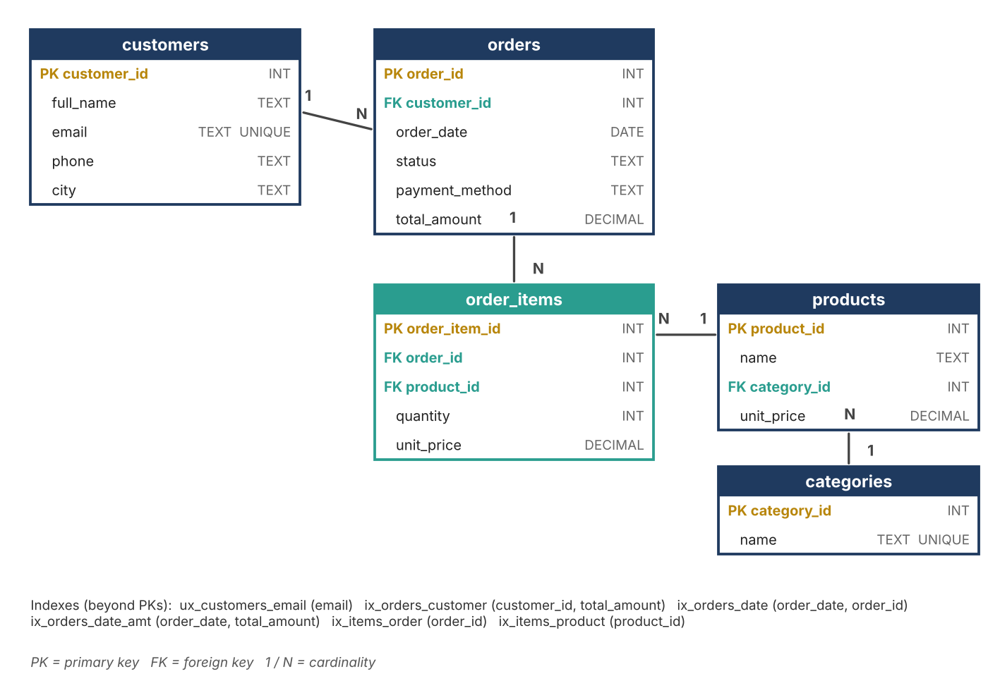
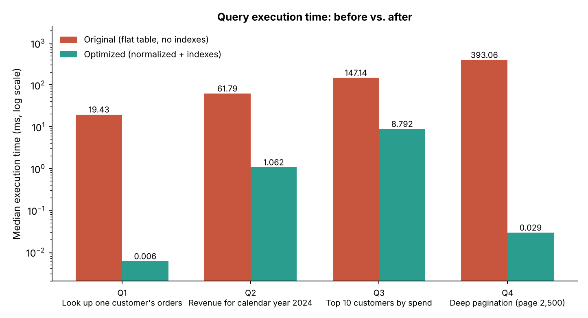

# SQL Query Optimization & Database Schema Design

Week 1 task for the Virtual SQL Developer Internship: analyse slow SQL queries, design a better
schema, and document the optimization strategies.

A legacy e-commerce database stored as **one wide, unindexed table** (`orders_flat`) is compared
with a **normalized (3NF), indexed schema** holding identical data. Four representative queries are
profiled with `EXPLAIN QUERY PLAN`, rewritten, and re-measured.

**Full write-up:** [`docs/Week1_SQL_Optimization_Schema_Report.docx`](docs/Week1_SQL_Optimization_Schema_Report.docx)

## Results

Median of 7 runs on 300,150 order lines (SQLite 3.45.1, synthetic data).

| Query | Original | Optimized | Speed-up | Technique |
|---|---|---|---|---|
| Q1 Customer lookup | 19.43 ms | 0.006 ms | ~3,238x | Unique index + indexed join |
| Q2 Revenue for 2024 | 61.79 ms | 1.062 ms | ~58x | Sargable date range + covering index |
| Q3 Top 10 customers | 147.14 ms | 8.792 ms | ~17x | Integer key + covering index |
| Q4 Deep pagination | 393.06 ms | 0.029 ms | ~13,554x | Keyset pagination |

Table data: 38.2 MB (flat) vs 13.4 MB (normalized).
Timings vary a little from run to run and by machine; the execution-plan changes
(`SCAN` to `SEARCH ... INDEX`) are the stable finding.




## Repository layout

```
schema/      legacy_orders_flat.sql, normalized_schema.sql, indexes.sql
queries/     original/ and optimized/ versions of Q1-Q4
scripts/     benchmark.py (builds data, times queries), make_charts.py
results/     results.json (timings and execution plans)
docs/        analysis report (.docx) and diagrams
```

## Reproduce

Requires Python 3.9+ (SQLite is built in).

```bash
pip install -r requirements.txt
python scripts/benchmark.py     # creates data/shop.db and results/results.json
python scripts/make_charts.py   # regenerates docs/images/*.png
```

Run both commands from the repository root.

## Key ideas demonstrated

- Read the execution plan before changing anything.
- Do not wrap indexed columns in functions (`strftime(...)`); use range predicates.
- Index filter, join and sort columns; use covering indexes for hot queries.
- Replace `OFFSET` with keyset pagination for deep paging.
- Normalize for integrity first, then denormalize deliberately (`orders.total_amount`,
  `order_items.unit_price`) where measurements justify it.

## Limitations

Data is synthetic and uniformly distributed, and the benchmark runs on SQLite. Absolute numbers will differ
on PostgreSQL or MySQL; re-test with `EXPLAIN ANALYZE` on your target engine.

## License

MIT
